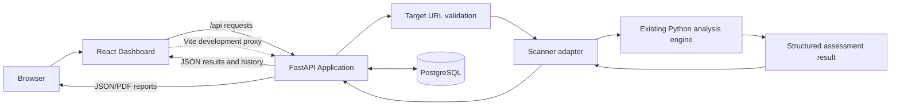
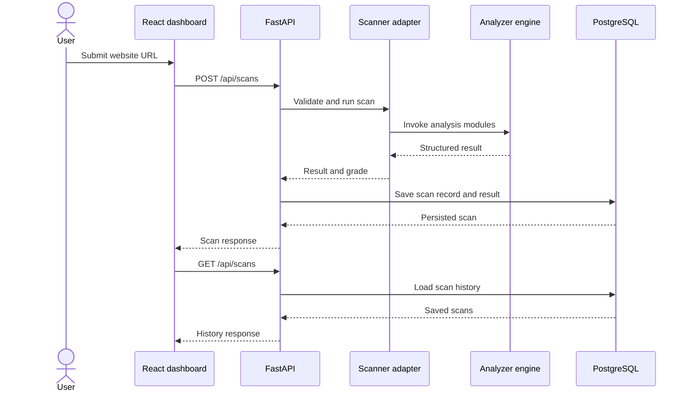

# Architecture

## System diagram

## Components

### React dashboard

The frontend accepts a target URL, submits scan requests, shows current scan results, and retrieves scan history. It is developed with Vite, and the Vite development server proxies `/api` requests to the FastAPI service. Tailwind CSS provides styling, with Lucide React for icons.

The current result view is based on the analyzer's nested `result` object. Key areas include `cookies`, `web_beacons`, and `security_transmission`. Transmission-security data can include protocol values, cipher-suite records, public-key metadata, and certificate metadata.

### FastAPI application

`api/main.py` exposes health, scan submission, history, individual scan retrieval, and report-download routes. It validates request payloads, delegates scan execution, persists results, and returns JSON.

The current scan operation runs synchronously inside the HTTP request. A slow target or slow analysis module can therefore keep that request open and limit concurrency.

### Scanner adapter

`api/scanner.py` connects the HTTP API to the existing Python analyzer. The adapter normalizes and validates the target URL, calls the analyzer functions, and returns a structured assessment result. This separation keeps the API routes from needing to understand every legacy analyzer module.

The URL validation is a baseline safeguard, not a complete isolation boundary. Redirects, DNS rebinding, alternate IP representations, and changing DNS responses must be considered before exposing this endpoint to untrusted users.

### Persistence: PostgreSQL and SQLAlchemy

`api/database.py` configures the SQLAlchemy engine and session factory based on `DATABASE_URL`; a SQLite URL can be used for local fallback where configured. `api/models.py` defines the saved scan record, including the target, timestamp, status, grade, result JSON, and error details.

`compose.yaml` defines the local PostgreSQL service. A named Docker volume preserves its database files between container restarts. Do not use `docker compose down -v` unless you intend to remove the persistent volume and its data.

### Reports

The JSON and PDF report endpoints export a previously saved scan result. Keeping reports tied to the stored record makes the downloaded output comparable with the dashboard history; downloading a report should not silently trigger another scan.

## Scan lifecycle

## Data flow and trust boundaries

1. The browser submits an untrusted URL to the API.
2. The API validates the request and delegates to the scanner adapter.
3. The scanner makes outbound requests to the target and invokes analysis modules.
4. The analyzer returns its results, which are saved in PostgreSQL.
5. The frontend displays the saved result and history.
6. Report endpoints serialize the saved assessment into downloadable JSON or PDF.

The API performs outbound network requests based on user input. Server-side request forgery (SSRF) is consequently a major risk and needs defense in depth, including redirect validation and outbound network restrictions.

## Current result contract

The current nested result shape includes:

- `cookies`: `grade`, `score`, `details`
- `web_beacons`: `grade`, `score`, `url`
- `security_transmission`: `hostname`, `grade`, `note`, `protocol`, `key`, `cipher`, `certificate`
- top-level `target` and `grade`

Fields can vary depending on what the analyzer returns. A missing module or empty object/list means data was not reported in that field; it must not automatically be displayed as a definitive pass.
